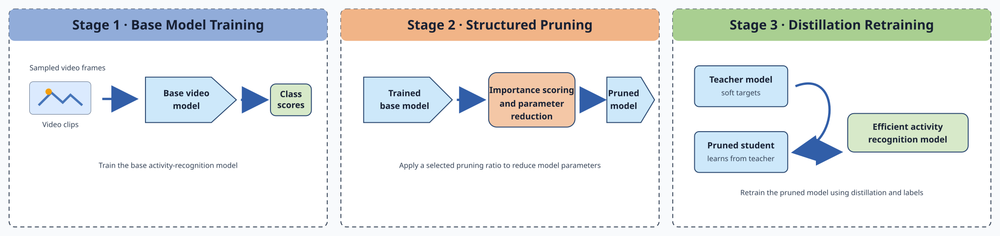

# PDNet

<p align="center">
  
</p>

**Paper:** [Resource-efficient Deep Learning for Real-time Recognition of Worker Activities During Industrial Assembly](https://arxiv.org/abs/2610.26491)

PDNet explores resource-efficient video-based recognition of worker activities in industrial assembly settings. It builds on spatiotemporal video modeling with SlowFast and the MECCANO egocentric industrial-activity dataset, studying the trade-off between recognition capability and computational cost through structured pruning and knowledge distillation.

## Abstract

Recognizing worker activities from video can support understanding of industrial assembly workflows, but video models can be expensive to train and run. PDNet investigates a resource-efficient approach to this problem, using spatiotemporal video modeling based on the SlowFast framework and the MECCANO egocentric industrial-activity dataset. The work focuses on balancing recognition capability with computational cost, including structured pruning and distillation-based retraining. This repository links the paper to its dataset and framework resources. See the [paper](https://arxiv.org/abs/2610.26491) for the official abstract, complete method, experimental setup, and reported results.

## Paper and citation

- **Paper:** [arXiv:2610.26491](https://arxiv.org/abs/2610.26491)
- **Citation metadata:** [`CITATION.cff`](CITATION.cff)

```bibtex
@article{baba2026resourceefficient,
  title         = {Resource-efficient Deep Learning for Real-time Recognition of Worker Activities During Industrial Assembly},
  author        = {Baba, Malek},
  journal       = {arXiv preprint arXiv:2610.26491},
  year          = {2026},
  doi           = {10.48550/arXiv.2610.26491},
  url           = {https://arxiv.org/abs/2610.26491}
}
```

## Data and methods

- **MECCANO dataset:** [official dataset repository](https://github.com/fpv-iplab/MECCANO). Obtain the data from its maintainers and follow their access terms; this repository does not redistribute dataset files.
- **SlowFast / PySlowFast:** [official implementation](https://github.com/facebookresearch/SlowFast).
- **SlowFast paper:** [SlowFast Networks for Video Recognition](https://arxiv.org/abs/1812.03982).
- **Related implementation:** [Master-Thesis-Resource-Efficient-PySlowFast](https://github.com/mscmalekbaba/Master-Thesis-Resource-Efficient-PySlowFast).

See [`data/`](data/README.md), [`methods/`](methods/README.md), and [`reproducibility/`](reproducibility/README.md) for dataset, method, and reproduction notes.
